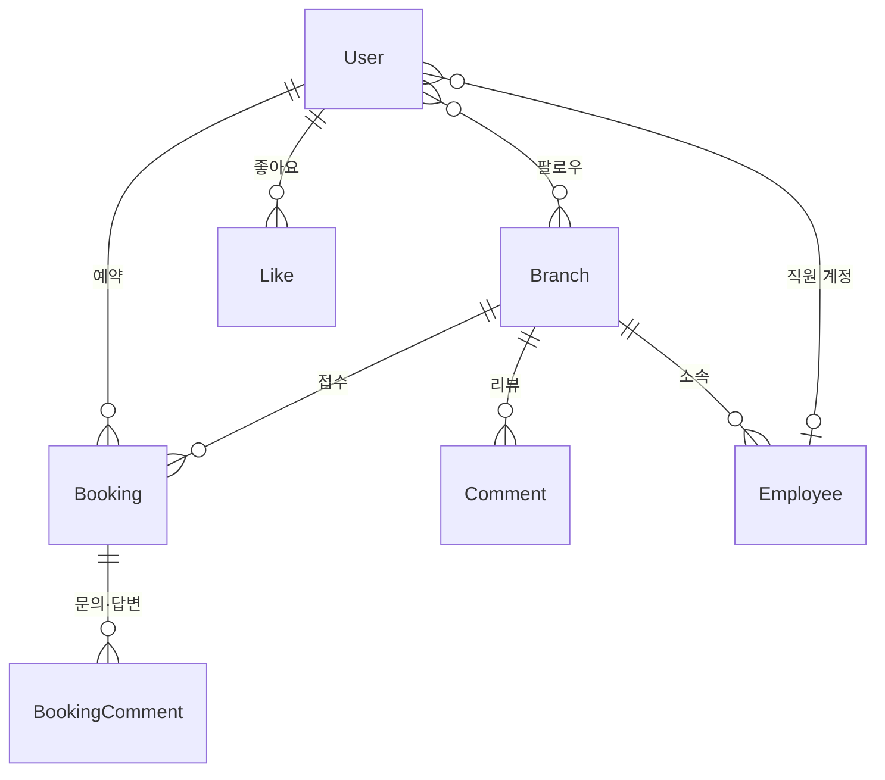

# Hana Reservation

은행 영업점 방문 예약 웹 서비스입니다. 고객은 지점을 찾아 방문 일시와 업무를 예약하고, 예약 건마다 문의를 남기면 SMS로 알림을 받습니다.

2022년 KAIST 전산학 교육과정의 팀 프로젝트로 진행했습니다. 본 저장소의 애플리케이션 코드는 직접 설계·구현했으며, 2022년 6월 프로젝트 시연회에서 PythonAnywhere에 배포해 시연했습니다. 학습 목적의 프로젝트로, 실제 금융기관 서비스와는 관련이 없습니다.

> **공개 안내**
> 이 저장소는 교육·포트폴리오 목적으로 2026년 10월에 공개했습니다. 공개 전에 보안 점검을 거쳐 하드코딩돼 있던 모든 자격증명(API 키, OAuth Secret, SMTP 비밀번호 등)을 폐기·재발급하고, 커밋 이력에서 시크릿과 실사용자 데이터를 제거했습니다.
> 2022년 학습 당시의 코드는 최대한 그대로 보존했으며, 점검에서 확인한 취약점 일부는 수정하지 않고 [보안 셀프 리뷰](#보안-셀프-리뷰-2026)에 기록해 두었습니다. **운영 환경에 그대로 배포하지 마세요.**

| 항목 | 내용 |
|---|---|
| 기간 | 2022.05.19 – 2022.06.23 (약 5주) |
| 역할 | 백엔드·프론트엔드 구현 전반 (애플리케이션 커밋 전량 작성) |
| 스택 | Python 3.8, Django 2.2, django-allauth, Twilio API, Naver Maps API, SQLite |

## 주요 기능

**인증·회원**
- 이메일 기반 회원가입·로그인, 이메일 인증, 비밀번호 변경·재설정 (django-allauth)
- 카카오·네이버 소셜 로그인
- 커스텀 `User` 모델(이름, 휴대폰, 프로필 사진, 소개)과 최초 로그인 시 프로필 설정을 강제하는 미들웨어

**지점**
- 지점 목록·페이지네이션, 지점명·전화번호·주소 통합 검색
- 지점 상세 페이지에 Naver Maps 지오코딩으로 위치 표시
- 지점 링크는 네이버·카카오 플레이스 URL만 허용하는 커스텀 validator
- 직원 계정이 소속 지점 정보를 수정하는 화면 (직원 전용, 예외 처리 미완성)

**예약**
- 날짜·시간대(30분 단위)·업무 유형을 선택하는 방문 예약, 첨부 이미지 최대 3장
- 본인 예약만 취소할 수 있는 객체 단위 권한 검사
- 예약 건별 문의 댓글과 답변
- 예약 완료·문의 답변 등록 시 Twilio SMS 알림

**커뮤니티**
- 지점 리뷰 댓글 작성·수정·삭제 (작성자 본인만)
- 지점·예약·댓글에 대한 좋아요: `GenericForeignKey`로 대상 모델과 무관하게 하나의 `Like` 모델로 처리하고, `unique_together`로 중복 좋아요를 DB 수준에서 방지
- 지점 팔로우, 팔로잉·팔로워 목록

## 설계



**접근제어.** 반복되던 권한 검사를 믹스인 3종으로 리팩터링해 뷰에서 조합했습니다 (`booking/mixins.py`).

| 믹스인 | 조건 | 적용 |
|---|---|---|
| `LoginAndVerificationRequiredMixin` | 로그인 + 이메일 인증 완료 | 예약·댓글 작성, 좋아요, 팔로우 |
| `LoginAndOwnershipRequiredMixin` | 예약 소유자 | 예약 취소 |
| `LoginAndOwnershipRequiredMixin2` | 댓글 작성자 | 댓글 수정·삭제 |

## 개발 과정

| 시기 | 진행 내용 |
|---|---|
| 5월 3–4주 | 프로젝트 구성, 로그인, 로그인 사용자만 예약 가능하도록 제한 |
| 5월 말 | 예약 소유자 권한 검사, 이메일 인증·비밀번호 재설정 안정화, 프로필 설정 미들웨어 |
| 6월 1–2주 | 지점 상세·이미지·링크, 댓글·좋아요 모델, 관리자 Inline 편집 |
| 6월 2–3주 | 접근제어 믹스인 리팩터링, 팔로우, 예약 첨부 이미지, 예약 문의 댓글 |
| 6월 3–4주 | Naver Maps 연동, Twilio SMS 알림, 시연 준비 |

## 실행 방법

```bash
python3.8 -m venv .venv && source .venv/bin/activate
pip install -r requirements.txt
cp .env.example .env          # 필요한 값만 채웁니다
python manage.py migrate
python manage.py createsuperuser
python manage.py runserver
```

외부 연동 키는 모두 선택 사항입니다. 비워두면 해당 기능만 비활성화됩니다.

| 환경변수 | 용도 |
|---|---|
| `DJANGO_SECRET_KEY`, `DJANGO_DEBUG`, `DJANGO_ALLOWED_HOSTS` | Django 기본 설정 |
| `KAKAO_*`, `NAVER_*` | 소셜 로그인 |
| `EMAIL_HOST_USER`, `EMAIL_HOST_PASSWORD` | 이메일 인증 발송 (SMTP) |
| `TWILIO_*`, `SITE_URL` | SMS 알림 (미설정 시 발송 생략) |

## 보안 셀프 리뷰 (2026)

보안 업무를 하면서 2022년의 코드를 공개 전에 다시 점검했습니다.

**조치 완료**
- 소스에 하드코딩돼 있던 Django `SECRET_KEY`, OAuth Client Secret, Twilio 자격증명, SMTP 비밀번호를 폐기하고 환경변수로 분리했습니다.
- 커밋 이력에서 시크릿 문자열과, 시크릿이 컴파일돼 남아 있던 `.pyc` 파일, 실사용자 데이터가 담긴 `db.sqlite3`, 업로드 이미지를 제거했습니다 (`git filter-repo`). 작성자와 커밋 일자는 그대로 보존했습니다.
- `.gitignore`와 `.env.example`을 추가했습니다.

**남아 있는 취약점과 개선 방향**

학습 당시 코드를 보존하기 위해 아래 항목은 수정하지 않고 기록으로 남깁니다.

| 항목 | 내용 | 개선 방향 |
|---|---|---|
| 예약 상세 IDOR | `BookingDetailView`에 권한 검사가 없어, 예약 ID만 바꾸면 다른 고객의 예약을 조회할 수 있음 | 예약 소유자·소속 지점 직원만 조회하도록 `get_queryset` 제한 |
| 지점 수정 예외 처리 | 직원 계정이 아닌 사용자가 지점 수정 URL에 접근하면 500 오류 발생 | 직원 여부 검사 믹스인 추가 후 403 반환 |
| 운영 설정 | `DEBUG` 기본값 True, 정적·미디어 파일을 Django가 직접 서빙 | 배포 설정 분리, 웹 서버·스토리지로 서빙 |
| 테스트 | 자동화 테스트 없음 | 권한 검사 뷰부터 단위 테스트 작성 |

Naver Maps 클라이언트 ID는 브라우저에서 호출되는 공개용 식별자로, 콘솔에서 허용 도메인을 제한해 사용합니다.
